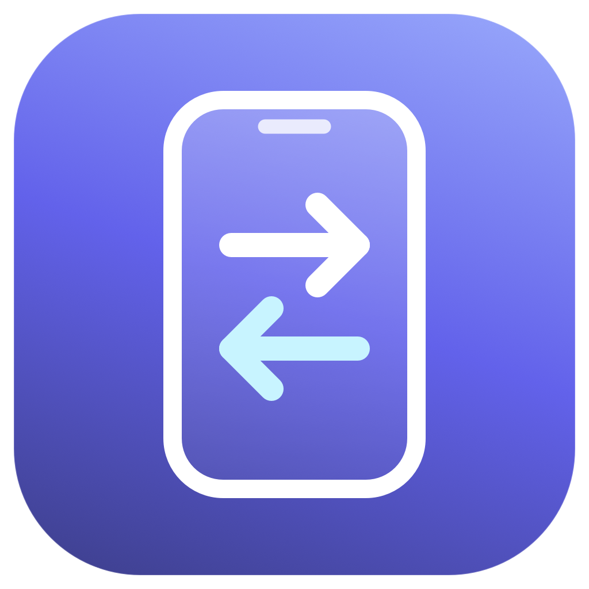
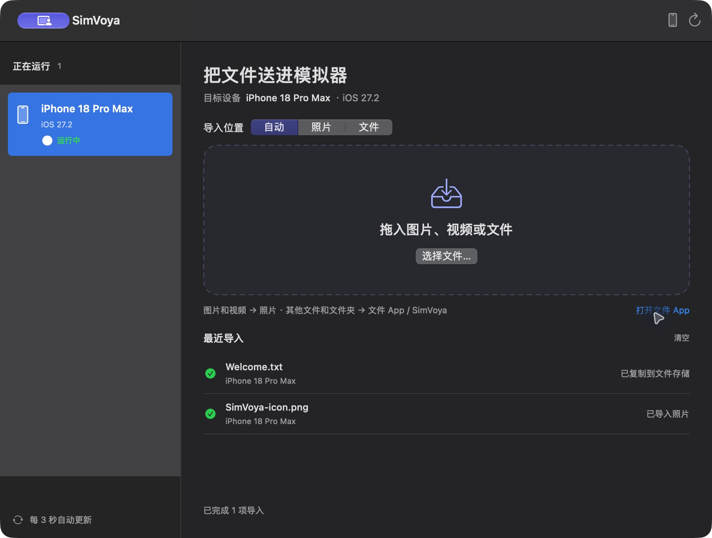
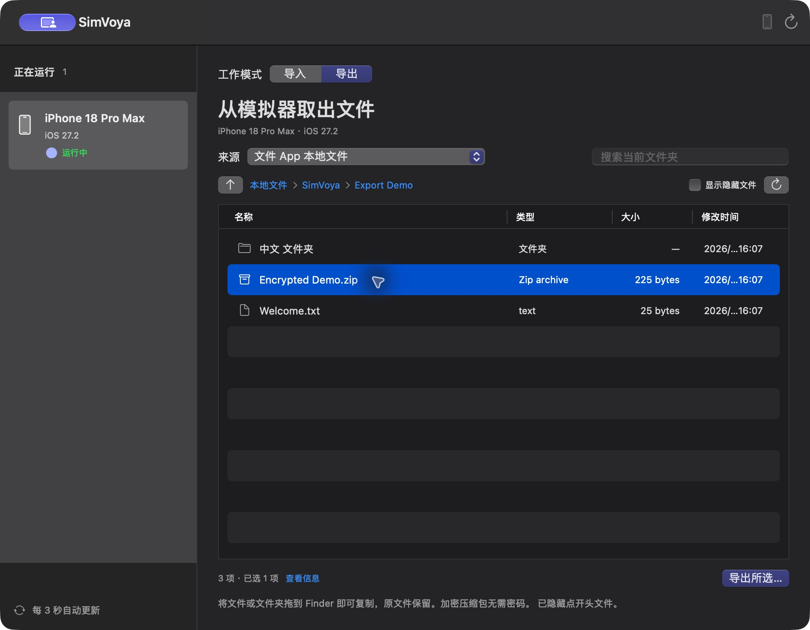
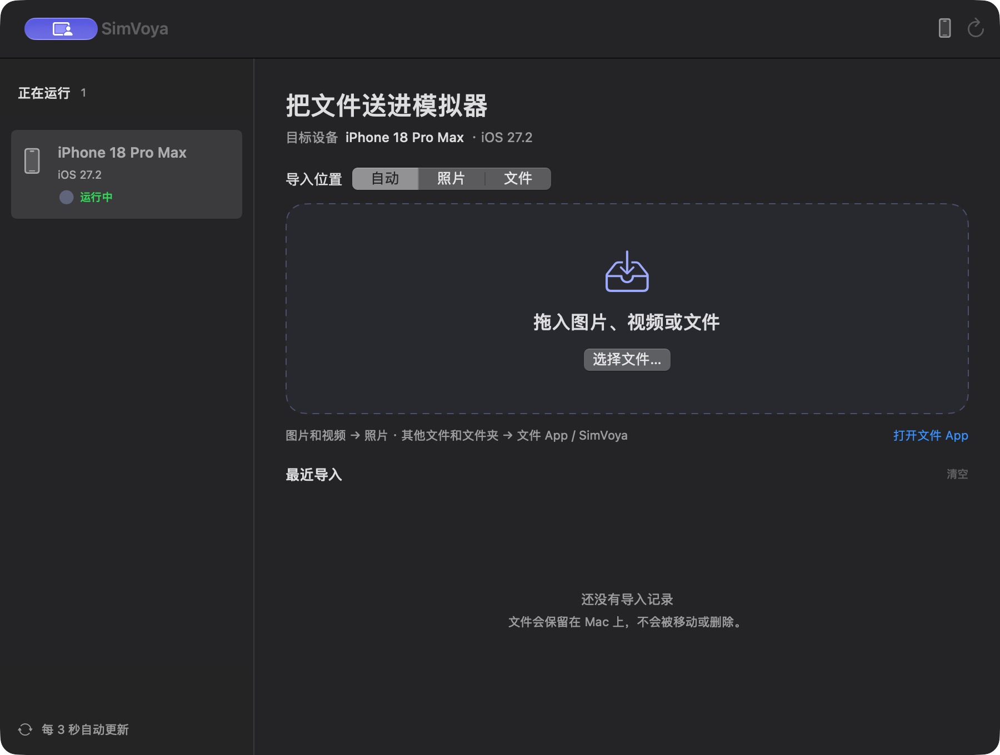

<p align="center">
  
</p>

<h1 align="center">SimVoya</h1>
<p align="center">在 Mac 与 Xcode 模拟器之间传递图片和文件。<br>Import files into iOS Simulators and export simulator files back to your Mac.</p>
<p align="center">
  <a href="LICENSE">MIT License</a> · SwiftUI + AppKit · macOS
</p>

SimVoya 是一个轻量的原生 macOS 工具：向运行中的模拟器导入图片与文件，或浏览模拟器中的文件、App 数据和共享容器，将选中的文件或文件夹拖到 Finder 导出。无需账号、云同步或额外运行时。

设备列表常驻左栏，可在同一窗口切换导入与导出。导入页显示目标设备、文件去向和最近导入结果，导出页通过路径导航和文件列表浏览模拟器目录。

## 为什么做这个项目？

**项目起因是 Xcode 27 的 Device Hub 缺失原先 Simulator 的 Finder 拖拽导入体验。** 在开发和测试 iOS App 时，导入测试图片、JSON、PDF 或备份文件本应很简单，却需要反复查找模拟器 ID、运行命令和定位存储容器。SimVoya 把这些操作放进一个窗口。

版本背景与边界：

- **Xcode 27** 引入 Device Hub 替代 Simulator，参见 [Apple 官方介绍](https://developer.apple.com/news/?id=lvart8mq)。
- 本项目针对这一代 Device Hub 的拖拽导入缺失而开发；项目本机验证环境为 **Xcode 27.2（27B52）+ iOS 27.2 Simulator**。[Apple Developer Forums 的讨论](https://developer.apple.com/forums/thread/846994)记录了同类问题和普通文件的导入方法。这不表示逐个验证过所有 27.0–27.2 版本。
- **Xcode 27.3 beta**：Apple DTS 在上述讨论中表示 Device Hub 已恢复接收拖拽内容，并指向 [27.3 beta Release Notes](https://developer.apple.com/documentation/xcode-release-notes/xcode-27_3-release-notes)。因此，本项目不声称“Xcode 27 之后永远无法拖拽”。升级后可先尝试系统自带功能；SimVoya 仍可提供统一的设备选择、导入模式和逐项结果。

这是 Xcode / Device Hub 的工作流变化，不能简单归因于所有 macOS 27 设备。SimVoya 不修改 Xcode，也不修补 Device Hub。

## 实际效果

以下为 2026-11-04 的中文界面实机截图。演示图片使用项目自身图标，文本为专门创建的示例文件。

### 导入图片与普通文件



### 文件浏览与导出（1.1.0）



导出页面截图来自真实模拟器的测试目录。按钮批量导出已实际验证；原生 file promise 的文件/目录 fulfillment 集成测试已通过，Finder 跨窗口鼠标实拖尚未完成验收。详见 [导出验证记录](docs/EXPORT_VALIDATION.md)。

### 主窗口与运行设备



截图环境：Apple Silicon Mac、Xcode 27.2、iPhone 18 Pro Max / iOS 27.2 Simulator，2026-11-04。截图通过「选择文件」入口完成导入；Finder 跨窗口鼠标拖拽尚未完成自动化实拖验收。

## 功能

- 仅列出 **Booted** 且可用的模拟器，每 3 秒自动刷新，也可按 **⌘R** 手动刷新。
- 从 Finder 拖入内容，或按 **⌘O** 打开文件选择面板。
- **自动 / 照片 / 文件**三种模式，明确显示内容去向。
- 支持普通文件和文件夹，保留文件夹结构；同名内容自动添加编号，不覆盖已有文件。
- 逐项显示成功与失败，保留错误详情；批次绑定选定设备，不因设备列表变化而改投其他设备。
- 普通文件复制后进行 SHA-256 内容校验；源文件不会被移动或删除。
- 导出页以列表显示文件名称、类型、大小和修改时间，支持目录导航、多选、当前层搜索和隐藏文件开关。
- 可浏览文件 App 本地存储、应用数据容器、共享容器以及模拟器 data 根中的可访问内容。
- 文件、文件夹和加密压缩包通过 macOS file promise 拖到 Finder，复制后校验内容；保留导出按钮作为替代入口。
- 原生 SwiftUI + AppKit，无第三方包依赖；本地传输无需网络或 Apple ID。

## 快速开始

当前提供源码构建；本仓库不包含预编译的 `.app`。

### 环境要求

- 项目最低部署目标为 **macOS 14**；实际验证在 Apple Silicon Mac 上完成。
- 已安装完整 Xcode，完成首次运行设置，并安装 iOS Simulator runtime。
- 命令行开发工具指向需要使用的 Xcode：

```sh
xcode-select -p
xcrun simctl list devices booted
```

本机验证工具链为 Xcode 27.2 / Swift 6.4.2。使用其他 Xcode 版本时，请同时满足该版本自身的系统要求；其他系统与工具链组合尚未逐一验证。

### 构建并运行

```sh
git clone https://github.com/LFate/SimVoya.git
cd SimVoya
./scripts/build-app.sh
open dist/SimVoya.app
```

也可以在 Xcode 中直接打开 `Package.swift`。脚本将生成 `dist/SimVoya.app`，包含 App 图标和本机 ad-hoc 签名。此签名用于本地运行，不是 Developer ID 签名或 Apple 公证；对外分发二进制需要另外完成签名与公证。

### 导入内容

1. 在 Xcode / Device Hub 中启动模拟器。
2. 打开 SimVoya，在左侧选择目标设备。
3. 选择导入模式，拖入文件，或点击「选择文件…」。
4. 查看逐项结果；普通文件可通过「打开文件 App」前往模拟器查看。

| 模式 | 规则 | 在模拟器中查看 |
| --- | --- | --- |
| 自动 | 图片、视频进入照片；其他文件及文件夹进入文件存储 | 照片，或文件 App → 我的 iPhone / iPad → SimVoya |
| 照片 | 仅接受图片、视频；实际格式兼容性取决于 `simctl addmedia` | 照片图库 |
| 文件 | 所有内容，包括图片，作为普通文件复制 | 文件 App → 我的 iPhone / iPad → SimVoya |

“已复制到文件存储”表示复制及内容校验通过，不等同于 Files UI 已刷新。如未显示，请重新打开模拟器的文件 App。失败项可以重新拖入重试。「清空」只清除本次会话记录，不删除磁盘内容。

### 从模拟器导出到 Mac

1. 在左侧选择运行中的模拟器，切换到「导出」。
2. 选择文件来源，双击文件夹逐层进入；可打开隐藏文件显示。
3. 选择一个或多个文件、文件夹或压缩包，直接拖到 Finder 文件夹或桌面；也可点击「导出所选…」选择 Mac 保存位置。
4. 等待实际复制与校验完成，在结果区查看每项状态，并在 Finder 中显示导出的副本。模拟器原文件保留。

| 来源 | 可浏览内容 |
| --- | --- |
| 文件 App 本地文件 | LocalStorage 的本地文件根，包含 SimVoya 以外的子目录 |
| 应用数据 | 可发现的系统和用户 App 数据根，以及 Documents、Library、tmp 等下层目录 |
| 共享容器 | 可发现的 App Group 数据目录 |
| 设备数据 | 所选模拟器 data 根中的其他可访问目录（高级位置） |

目录按层读取，搜索只过滤当前层。文件夹大小不递归计算；未知元信息不表示零字节。符号链接可以显示，但不能跟随或导出。未下载的云端文件或虚拟提供器内容不能保证可读取；设备 data 根也不等同于 simulator runtime 的全部系统卷。

加密压缩包按原始字节复制，不解压、不询问密码。源内容正在变化时校验可能失败，请等待生成完成，或先停止相应 App 写入，再重试。SHA-256 校验不等同于文件系统一致性快照。

Finder 拖出使用接收端给出的精确目标路径；如目标冲突且 Finder 未提供新名称，会安全失败而不会覆盖。按钮导出则自动生成编号副本。

## 实现与兼容限制

- 设备发现与照片导入使用 `xcrun simctl`，每个批次使用明确的模拟器 UDID。
- 普通文件精确发现 DocumentsApp 的 `group.com.apple.FileProvider.LocalStorage` 容器，以 `rsync` 复制并校验内容，最终放入 `File Provider Storage/SimVoya`。
- 普通文件路径是来自 [Apple Developer Forums 的兼容性方案](https://developer.apple.com/forums/thread/846994)，**不是稳定的公开任意文件导入 API**。未来 runtime 布局变化时可能失效；无法发现存储目录时会明确报错。
- 只支持运行中的模拟器，不支持真机；普通文件导入依赖 iOS / iPadOS 的文件 App，不保证其他平台适用。
- 导入或导出包含符号链接的文件夹时会被拒绝；导出浏览列表可显示链接信息。
- 子进程使用参数数组，逐项串行执行并设置超时，不执行拼接的 shell 命令。
- App 不启用 App Sandbox，以便调用 Xcode 工具和访问模拟器容器；无需管理员或辅助功能权限。
- 本次仅验证了单台 Booted iPhone；多设备切换、批量视频等真实场景尚未完成全部验收。详见 [验证记录](docs/VALIDATION.md)。

早期本地版本使用过 SimDrop 名称。旧版已导入的内容仍保留在原有 `SimDrop` 文件夹；新版导入目标为 `SimVoya`，不会自动移动或删除旧内容。

## 开发与测试

```sh
CLANG_MODULE_CACHE_PATH=/tmp/simvoya-clang-cache \
SWIFTPM_MODULECACHE_OVERRIDE=/tmp/simvoya-module-cache \
swift test --disable-sandbox --cache-path /tmp/simvoya-swift-cache
```

测试覆盖设备解析、精确容器发现、媒体路由、重名处理、内容校验、符号链接拒绝以及命令失败与超时。

真实导入自检（会把指定内容加入指定模拟器）：

```sh
dist/SimVoya.app/Contents/MacOS/SimVoya \
  --smoke-test SIMULATOR_UUID /absolute/path/photo.png /absolute/path/sample.txt
```

重新生成 PNG 图标：

```sh
swift -module-cache-path /tmp/simvoya-icon-module-cache scripts/render-icon.swift
```

项目采用轻量分层：`ContentView` / `AppModel` 处理导入界面状态，`SimulatorService` 发现设备，`ImportService` 导入和校验；`ExportModel`、`FileBrowserService` 和 `ExportService` 管理文件浏览与导出，`ExportFileTable` 桥接原生 file promise，`ProcessRunner` 在后台执行命令。

- [UI 设计](docs/UI_DESIGN.md)
- [架构设计](docs/ARCHITECTURE.md)
- [导出 UI 设计](docs/EXPORT_UI.md)
- [导出架构](docs/EXPORT_ARCHITECTURE.md)
- [导出验证](docs/EXPORT_VALIDATION.md)
- [命名记录](docs/NAMING.md)
- [验证记录](docs/VALIDATION.md)

欢迎提交 [Issue](https://github.com/LFate/SimVoya/issues) 或 Pull Request。报告问题时请附上 macOS、Xcode、Simulator runtime 版本、文件类型和可复现步骤，并移除日志中的个人文件路径等隐私信息。

## 来源与许可证

SimVoya 由 LFate 发起，使用 AI 编程协作完成界面、架构和原生实现；项目并非从其他 GitHub App 仓库复制或 fork。普通文件导入思路参考了上述公开论坛讨论；实际界面截图来自本项目运行。

源码、原创图标及项目文档采用 [MIT License](LICENSE)。允许使用、修改、再分发和商用，须保留版权及许可证声明，软件按原样提供，不作担保。Apple、Xcode、Simulator 等名称属于各自权利人；本项目不是 Apple 官方产品。
