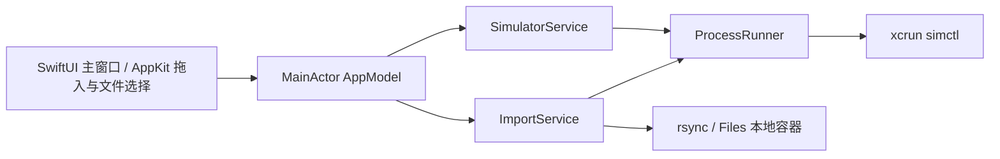

# SimVoya 架构与实现方案

## 目标与约束

沿用 UI_DESIGN.md 的原生单窗口界面。只向用户明确选择的 Booted 模拟器导入内容；图片与视频进入照片，普通文件与文件夹进入 Files 本地存储的 SimVoya 目录。导入必须不阻塞 UI、保留原文件、逐项报告真实结果，设备变化不能导致导错设备。

## 技术选择与取舍

| 方案 | 收益 | 代价 |
| --- | --- | --- |
| SwiftUI + AppKit + Foundation Process（采用） | 原生拖拽、系统外观、无需第三方依赖，直接调用 Xcode 工具 | 需自行处理子进程、打包与 File Provider 兼容边界 |
| Electron/Tauri | Web 布局迭代方便 | 增加运行时或工具链，原生行为及发布更复杂 |

构建采用 Swift Package Manager executable（macOS 14+），加 scripts/build-app.sh 生成 dist/SimVoya.app。无需生成 Xcode 工程；Xcode 可直接打开 Package.swift。脚本 swift build -c release，建立 Contents/MacOS、Resources、Info.plist，生成 .icns 并 ad-hoc codesign。App 禁用 App Sandbox，因为必须读取 Xcode Simulator 容器及调用 simctl；不要求辅助功能或管理员权限。首次发布暂无 Developer ID/notarization，当前交付面向本机直接运行。

## 模块边界

建议文件：Sources/SimVoya/SimVoyaApp.swift、ContentView.swift、AppModel.swift、Models.swift、ProcessRunner.swift、SimulatorService.swift、ImportService.swift。简单层次即可，不引入 repository、事件总线或插件体系。

- `SimulatorDevice`: id=UDID、name、runtime；只接受 state=Booted 且 isAvailable 的设备，按名称再 UDID 稳定排序。
- `ImportMode`: automatic / photos / files。
- `ImportRecord`: UUID、源 URL、源文件名、冻结目标设备名称与 UDID、目的地、结果、最终文件名、错误详情。
- `AppModel @MainActor`: 设备、selection、加载错误、当前批次状态、最近 50 项历史；所有 UI 状态仅在主 actor 更新。
- `SimulatorService`: 解码 simctl JSON；runtime 名称由 runtime identifier 转为易读字符串；返回错误而非把失败当作空列表。
- `ImportService`: 冻结目标与模式，串行执行每个条目，完成一项就反馈一项。
- `ProcessRunner`: async 接口，Process + 参数数组，捕获 stdout/stderr、exit code、超时与取消。不得拼 shell 字符串。

## 子进程执行规则

执行 `/usr/bin/xcrun` 参数如 `["simctl", "list", "devices", "booted", "-j"]`；`rsync` 使用 `/usr/bin/rsync`。不得依赖用户 PATH。使用系统 active Xcode/DEVELOPER_DIR，不硬编码 Xcode.app。

Process 在后台队列运行；stdout/stderr 必须同步持续排空或重定向到唯一临时文件，避免 pipe buffer 填满死锁。完成后收集输出并清理资源。设备读取 15 秒、媒体导入及文件复制 120 秒超时；超时先 terminate，宽限后 SIGKILL，最后 waitUntilExit。取消同时终止子进程并等待退出后才更新批次。没有完整取消实现就不展示取消按钮，仍必须有超时保护。避免计时器与 termination handler 重复 resume continuation。

每 3 秒刷新，禁止重叠刷新；导入前重新确认冻结的 UDID 仍 Booted。首次自动选择第一台；后续保留 UDID，设备消失后置空并显示提示，不自动改选其他设备。批次进行中设备变化不会改变冻结目标。

## 导入路径

1. Finder URL / NSOpenPanel 经统一入口生成 URL 数组。丢弃非 file URL，并以逐项错误解释不可读、失效文件或不支持的对象。访问 security-scoped URL 时用 start/stopAccessingSecurityScopedResource 配对包住实际导入。
2. 每批次只允许一个导入任务；状态设定必须发生在主 actor、异步工作启动之前，以阻止重复提交。
3. automatic 用 UTType 识别 image/movie，其他文件和文件夹进入 files；photos 拒绝目录及非媒体。扩展名未知可尝试 addmedia，失败保留原始错误，不自动声称成功。
4. Photos：`simctl addmedia <具体 UDID> <绝对源路径>`；exit 0 后显示已导入照片。逐项执行换取可定位的失败结果，不用 `booted` 代替具体 UUID。
5. Files：`simctl get_app_container <UDID> com.apple.DocumentsApp groups`，按 tab 分隔精确找到 `group.com.apple.FileProvider.LocalStorage`。本机实际验证采用 `groups` 输出解析；直接传 group identifier 在该工具链上仅返回 usage，未作为实现路径。禁止使用错误语法 `groups <groupID>`，禁止猜测 UUID 路径。
6. 验证返回绝对路径、目录存在，目标严格限定在此容器下的 `File Provider Storage/SimVoya`。File Provider Storage 不存在时先尝试启动 Files 并重新发现；不能通过猜测其它目录兜底。只在确认存储根存在后创建 SimVoya 子目录。
7. 文件名只取 lastPathComponent，不允许 `.`、`..` 或路径穿越；如已存在则生成 `name (2).ext`，目录同理。串行队列内预留命名，不覆盖既有条目。
8. 使用 rsync `-r -- <source> <unique destination>`，目录源不带末尾斜杠时需明确采用“目标为唯一名称路径”的语义。避免 cp/FileManager.copyItem 触发已知零字节问题。建议先建立唯一临时 staging 目录，将 rsync 输出写入 staging 内，验证后 move 至最终唯一名称，再清理 staging；失败与取消不留下假成功的目标文件。目录包含 symlink 时拒绝，或使用 rsync 不跟随 symlink 且逐项说明，绝不能意外递归到目录外。
9. 复制后校验文件长度，建议 SHA256 比对；目录递归核对相对路径集合及文件大小，符号链接不跟随。校验失败显示失败。
10. 成功状态文案为“已复制到文件存储”，详情展示最终名称及“文件 → 我的 iPhone/iPad → SimVoya；如未出现请重新打开文件 App”。不把复制成功等价于 UI 已可见。提供打开 Files 按钮调用 simctl launch UDID com.apple.DocumentsApp。

文件方案是 Apple Developer Forums 描述的兼容性 workaround，不是 Apple 官方稳定的文件导入 API。未来容器结构变化时明确报错，不写入别的未知目录。来源：https://developer.apple.com/forums/thread/846994 。

## 交互与失败语义

拖入后立即执行，无多余确认。批次冻结设备、模式、文件列表；右侧显示目标快照、已完成数量和进度。每项记录保留 error stderr 的可展开详情，部分成功显示成功/失败数量。历史只留内存不持久化个人文件路径。清空历史不修改任何磁盘文件；导入时禁用清空或仅清理已完成记录。失败可通过重新拖入重试，文案明确。

无设备、设备查询失败、设备被关闭必须是不同状态。拖入处理异步完成前仅表示接受输入，不显示成功；对失败项不抛弃记录。关闭窗口可保留进程以完成批次，应用退出需终止正在运行的子进程，避免孤儿任务。

## 验证与交付

- Swift build 与打包检查：包内 executable、Info.plist、icns 存在，codesign --verify 通过，open dist/SimVoya.app 成功。
- 针对风险的逻辑测试：设备 JSON 解析及错误、selection 不漂移、路由分类、中文/空格文件名、重名命名、进程失败/超时、不覆盖文件与目录校验。可用小型自检 executable 或 XCTest，不为布局添加镜像测试。
- 真实 smoke test：使用用户当前 Booted iPhone，先创建仓库内独立测试 PNG、UTF-8 文本、带子文件目录。照片走 addmedia 验证 exit 0；文本和目录走正式 ImportService，检查目标内容与重名保留；目标位置不得预设旧容器 UUID。
- GUI 验证：真实设备显示、拖拽与文件选择同路径、批次进度/结果、打开 Files、普通文件在 Files 中可见。未能操作或确认的项目明确标注，不能把构建成功视为用户验收。
- 交付 README 含启动/构建方式、Xcode 要求、照片与文件路径、兼容限制；保留源码与 dist/SimVoya.app，最后启动 App 供用户查看。

## ADR-001：使用 Xcode 工具与本地存储适配

状态：接受。

simctl 对照片有直接支持，对任意文件没有同等导入命令。选择 addmedia 加可发现的 File Provider 容器，避免安装额外 iOS companion App，满足用户立即使用。代价是 Files 路径有版本兼容风险，因此必须精确发现、验证内容并诚实区分复制与 UI 可见。

## ADR-002：本地非沙盒 App 与轻量分层

状态：接受。

本工具必须调用开发工具并访问模拟器容器；采用非沙盒原生 App 与 SwiftPM 打包，减少依赖和配置。代价是后续商店分发不可直接沿用此方式；未来需要外部分发时再补 Developer ID、notarization 和更新机制。
