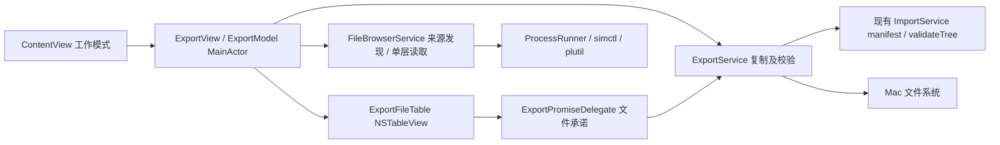

# SimVoya 文件浏览与导出架构

## 约束与技术选择

遵循 `EXPORT_UI.md`：沿用单窗口与设备栏，新增导入/导出工作模式。导出应覆盖当前模拟器 data 根内所有能够读取的内容，按层导航；加密压缩包按原始字节复制，无需密码，不解压、不修改模拟器源文件。本次交付为本机源码、测试与 App，不自动提交或推送 GitHub。

| 方案 | 收益 | 代价与结论 |
| --- | --- | --- |
| SwiftUI 工作区 + AppKit NSTableView + NSFilePromiseProvider（采用） | 原生多选、列排序、Finder 文件/文件夹承诺拖出；目标确定后才复制 | 增加一个 AppKit 桥接与委托生命周期管理 |
| SwiftUI onDrag 直接提供模拟器 file URL | 代码较少 | 接收端可能直接操作源路径，缺少可靠复制/校验/结果控制；不采用 |

不引入 DDD、数据库、文件索引或通用插件架构。文件发现、浏览、导出三项职责即可；现有导入服务保留，复用其内容校验与文件类型安全检查。

## 模块与依赖

建议新增 `ExportModels.swift`、`FileBrowserService.swift`、`ExportService.swift`、`ExportModel.swift`、`ExportView.swift`、`ExportFileTable.swift`。桥接与 promise 委托可放同文件，不额外拆框架。现有 ContentView 只接入工作模式与导出页；AppModel 保持设备发现与导入职责。全部文件访问与递归校验在后台执行，SwiftUI 和表格状态更新在 MainActor。

## 数据结构

- `SimulatorDevice` 增加 `dataPath: String?` 或 `dataURL: URL?`，默认 nil，保持现有三参数构造和测试兼容；从 `simctl list devices booted -j` 的 dataPath 解码。缺失时设备可导入，但导出页明确表示无法发现设备数据路径，禁止猜 UUID 路径。
- `ExportSourceKind`: localFiles / applications / sharedGroups / deviceData。
- `BrowserRoot`: 稳定 ID、来源类别、显示名称、辅助标识、物理根 URL、设备 data 根、可访问状态/原因。应用列表默认包含可发现的系统与用户 App，不用文件共享标记过滤。
- `BrowserEntry`: URL、名称、是否目录/包/符号链接、UTType 描述、可选字节数、可选修改/创建时间、可读状态、可靠识别的云端下载状态；条目 ID 使用完整标准化 URL，不用行索引。目录大小不递归计算，显示“—”。
- `ExportSnapshot`: 唯一 ID、设备 ID/名称、已验证 data 根、所选来源根、源 URL、原始名称、条目类型。拖拽开始即冻结，后续切换设备或排序不能更换内容。
- `ExportRecord`: 每项状态 preparing / copying / verifying / completed / failed、最终 destination URL、错误详情。取消拖拽不生成完成记录。

## 来源发现与按层浏览

1. 查询设备列表并取本批选择设备的真实 dataPath。规范化 URL 后存储，同时保留原显示路径。
2. `xcrun simctl listapps <UDID>` 返回 OpenStep property list。优先使用 Foundation PropertyListSerialization 解码（如果当前输出不支持则用 `/usr/bin/plutil -convert json -o - <临时输入文件>` 转换）；不使用 shell 拼接。ProcessRunner 当前无 stdin Data 接口，采用唯一临时文件并清理，避免为了这一处大改进程层。
3. 一次读取字典各应用的 CFBundleDisplayName（回退 CFBundleName、bundle ID）、DataContainer file URL 与 GroupContainers 字典。不要逐应用启动数十个 simctl 命令。
4. `文件 App 本地文件`：精确寻找 `com.apple.DocumentsApp` 的 `group.com.apple.FileProvider.LocalStorage`，对应 `File Provider Storage` 根；可用现有 groups 输出发现做回退，不能只暴露 SimVoya 子目录。
5. `应用数据`：展示所有具有数据容器信息的 App，进入数据根后能看到 Documents、Library、tmp 等真实目录。容器不存在/不可读时仍展示来源及原因，不伪造空目录。没有数据根的 App 可显示不可用项。
6. `共享容器`：按规范化物理路径去重，相同组记录所有已知归属 App；组名相同但路径不同不得混为一项。
7. `设备数据`：直接浏览已发现 data 根，以覆盖未映射应用、共享容器和其他目录；提供隐藏文件开关。该入口不允许向上跳到 Mac 的其他目录，也不宣称包含 simulator runtime 系统卷全部内容。
8. 单层 `contentsOfDirectory` 后按条目读取元信息；不存在/权限错误区别显示。不要递归搜索或计算目录大小。搜索仅当前层，应用来源层搜索名称和 bundle ID。
9. 可显示 symlink 的元信息，但禁用进入与导出；special files（socket/FIFO/device）显示其类型并禁用。可靠的 ubiquitous downloading 状态为未下载时禁用；不可可靠识别的 File Provider 后端只能按实际读取/复制错误处理。合法 0 字节文件允许导出。

## 路径边界与导航一致性

所有根都必须是 file URL，且规范化/解析 symlink 后位于所选设备 data 根内。比较路径组件或使用 root + `/` 前缀，不能用裸字符串前缀使 `root-other` 通过。

每次进入目录、读取列表、复制前都重新验证来源存在、路径不跨根、任一路径组件不经过非允许 symlink；根本身与容器的 canonical 路径必须在设备 data 根内。上一级与面包屑只在已选择 BrowserRoot 内导航；需要更广浏览时显式切换设备数据来源。

ExportModel 用 generation UUID / 递增请求编号区分 device、source、directory 的异步加载；返回前同时核对 generation、设备 ID、目录 URL，丢弃旧结果。切换来源/设备先清旧列表与选择，禁止显示新面包屑下的旧行。3 秒设备刷新不触发目录重复加载，不清除选择。⌘R 才刷新设备及当前来源/目录。

设备关闭后禁止新批次，清浏览数据。已开始导出的冻结源不转投其他设备，读取失败按项报告；即使关闭后数据仍可读，也不得使用当前新选中的设备覆盖源快照。

## 统一导出服务

提供两个显式入口：

- `export(snapshot, toDirectory:)`：按钮模式，计算唯一文件名后复制，返回实际名称。
- `fulfillPromise(snapshot, exactDestination:)`：Finder promise 模式，必须写入接收端给出的精确 URL；不得改写到 `url.deletingLastPathComponent()` 的其他自选名称后谎报成功。

服务步骤：

1. 验证快照、源可读、常规文件/目录，拒绝 symlink/特殊文件。收集源树 manifest 与文件元数据，在后台逐块哈希，避免把大文件完整读入内存。
2. 目标不得等于源、位于源目录内，或落在冻结模拟器 data 根内（导出应去 Mac 目标，不在模拟器内复制）。目标父目录必须存在、可写。
3. 在目标父目录创建本任务独有的 staging 目录；其内使用清晰的预建目录和 `source/ → staged/` rsync 语义，复用现有导入已验证的方式，保留空目录、隐藏内容与常规文件。源目录中有拒绝类型时整项失败并说明路径。
4. 复制使用参数化 rsync，具体设备/来源不由当前 UI 状态重新推导。设置超时；不能阻塞主线程。大目录校验阶段也需检查任务取消，至少让进度持续显示当前状态，不伪造字节百分比。
5. 比较复制前 manifest、staged manifest 与复制后的源 manifest；任何不一致或读取失败都按“源文件变化/校验失败”处理，不生成成功结果。该方式检测常见并发变化，不构成底层文件系统一致性快照；提示用户先停止 App 写入再导出活跃数据库或日志。
6. 校验通过后原子 move 到目标精确路径，FileManager move 不覆盖已有目标。如果外部程序抢占目标，安全失败或按钮模式重新选唯一名称；只清理本任务的 staging，不删除已有文件。
7. 返回实际 destination 与完成状态；失败清理 staging 并保留错误。永不删除或重命名模拟器源文件。加密 ZIP/7z 不读取解密内容，校验密文原始字节。

按钮同名处理保留两份，编号递增。Finder promise 的名称冲突交给 Finder 接收端选择新名称/处理；写入回调若 URL 已存在则安全失败，不覆盖、不私自更名。对此结果必须向用户显示可理解的原因，并提供按钮方式重新导出。

## NSTableView 文件承诺契约

- NSViewRepresentable coordinator 是数据源和委托。表格支持 multiSelection、doubleAction 进入目录、sortDescriptors、动态列宽、返回键与 ⌘A。
- `tableView(_:pasteboardWriterForRow:)` 为每个可导出行构造携带冻结 ExportSnapshot 的 NSFilePromiseProvider。UTType 为真实文件类型，未知用 public.data，文件夹使用 public.folder；这是文件夹本身的 promise，不能变成 ZIP。
- 只提供 file promise，不额外提供原始模拟器 `public.file-url`。设置本地/外部 draggingSourceOperationMask 为 `.copy`，绝不允许 `.move`。
- `filePromiseProvider(_:fileNameForType:)` 返回冻结原名，不做递归扫描。无效名称、不可导出条目在拖开始前拒绝。
- `filePromiseProvider(_:writePromiseTo:completionHandler:)` 收到的是最终精确目标 URL，在后台调用 `fulfillPromise`；成功或失败恰好调用 completion 一次。不能只返回一个源 URL，也不能复制尚未完成时提前 completion(nil)。
- `operationQueue(for:)` 返回专用后台 OperationQueue，限制并发（建议 1），防止同时对大文件大量哈希。若内部桥接 async 服务，保留任务直到完成，不在主线程 semaphore 等待。
- Coordinator / 导出模型强持有本次 providers 及 delegates，直到拖拽结束且所有已发起 fulfillment 完成。不能用临时局部 delegate 导致拖到 Finder 后对象释放；浏览刷新/视图切换不销毁在途批次。
- `draggingSession:endedAt:operation:` 的 `.none` 只表示未接收的拖拽，不记成功。已被接受的 promise 在 session 结束后仍可能继续复制，不可在 session 结束就释放 provider、取消复制或标记全部完成。
- 每次 callback 使用 item UUID 更新记录，不能读可变行索引。多选每项独立完成；按实际成功/失败数汇总。选择了父目录及后代时去重，仅保留最外层来源。

参考：[Apple Supporting Table View Drag and Drop Through File Promises](https://developer.apple.com/documentation/appkit/supporting-table-view-drag-and-drop-through-file-promises)、[写入回调契约](https://developer.apple.com/documentation/appkit/nsfilepromiseproviderdelegate/filepromiseprovider(_:writepromiseto:completionhandler:))。

## 最小实现顺序与验证

1. 数据模型、device dataPath 解码、listapps parser 与来源发现；用当前模拟器确认系统 App、用户 App、组与设备根均可展示。
2. 单层浏览和 ExportModel generation 保护；接入 SwiftUI 导入/导出切换。
3. ExportService 及按钮导出，验证文件/嵌套文件夹/空文件/中文空格名/重名不覆盖；再连接原生表格 promise 拖出。
4. 有意义单测：OpenStep/JSON 元数据解析和来源去重；边界逃逸及 symlink；目录导航错误；目录结构/加密ZIP字节一致；源变化、目标冲突、目标在源内；过期加载不覆盖新选择。
5. promise 委托集成测试直接传给临时 exactDestination，断言只写精确 URL、completion 一次、常规文件与目录都能落盘、冲突不覆盖；服务测试不能替代真实 Finder 拖拽验收。
6. 真实 simulator smoke：自建加密ZIP（测试专用已知密码，但导出不使用它）、带子目录和空文件的夹层。导入测试夹，走正式浏览服务找到文件并导出到 Mac 临时目录，验证 SHA256 相等、源保留；App 数据根至少逐级进入一个已安装 App 的 Documents 及其子目录。
7. `swift test`、release 打包和 codesign 校验；实际 GUI 通过多选把文件、文件夹、ZIP拖至 Finder，检查实际结果及取消拖拽。更新 README/验证记录，区分服务、promise回调和真实Finder拖拽证据，最后重启 App 供用户使用。

## ADR-EXPORT-001：使用 file promise 执行受控复制

状态：接受。

直接发送模拟器 URL 最简单，但接收端可能以不符合导出意图的方式操作真实源文件。选择 NSFilePromiseProvider，代价是需管理生命周期、异步 completion 和 Finder 精确 URL 合约；收益是复制、校验与错误结果由同一服务控制，且支持真正文件夹导出。

## ADR-EXPORT-002：发现根 + 按层浏览，不建全盘索引

状态：接受。

用户要求覆盖 App 文件夹及下层内容，但初次递归扫描会卡顿、触碰大量活跃文件，并使目录数据快速过时。选择元数据映射的友好根，额外提供设备 data 根补齐可访问范围；代价是搜索只限当前层。后续需要全盘搜索时可独立增加显式扫描任务，不阻塞当前浏览。
